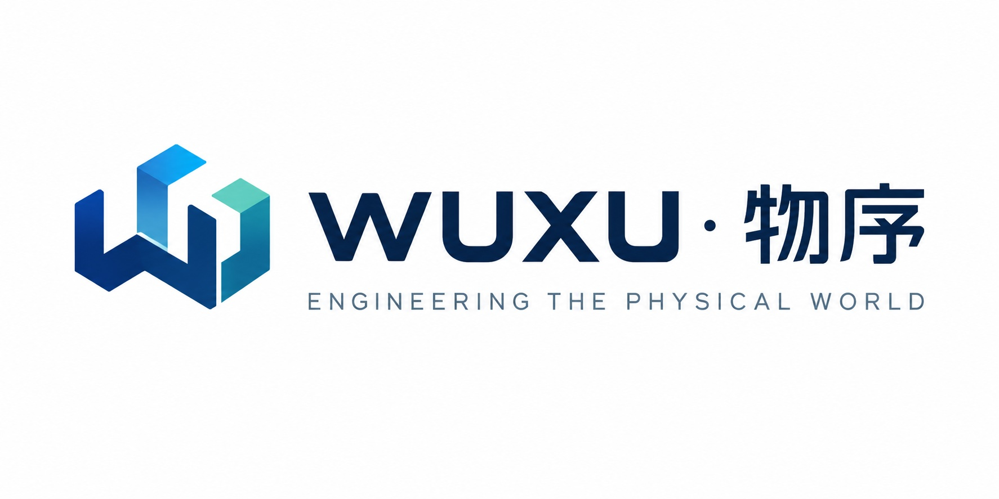

  

# WUXU · 物序

**Visual software for the physical world.**

Open-source, self-hosted tools for observing, understanding, and simulating physical systems.

[English](README.md) · [简体中文](README.zh-CN.md)

---

## Make the physical world legible

Industrial software is usually organized around production control, equipment automation, or plant management. WUXU starts from a different question: **how do we make physical systems visible, understandable, and simulable?**

We do not build one platform that tries to manage the factory, the equipment, the production line, the energy, the warehouse, and the logistics at once. We build focused products, each solving one clear problem — and let them connect through shared models.

Visualization is not a reporting layer bolted on at the end. It is the primary interface.

## Three capabilities

| Capability | Question it answers | Product domain |
|:---|:---|:---|
| **Observe** | What is happening right now? | Device monitoring, IoT, asset management |
| **Understand** | Why is it happening? | Data analysis, equipment relationships, diagnostics |
| **Simulate** | What happens if we do this? | Digital twins, simulation, forecasting |

## Product family

<table>
<tr><td width="50%" valign="top">

### 01 · Asset
**Equipment & asset management**

Device modeling, asset registry, state monitoring, sensor data, topology.

*Where is the asset, what state is it in, how is it managed?*

<b>Status:</b> first release in development

</td><td width="50%" valign="top">

### 02 · Twin
**Digital twins**

Device models, 3D scene modeling, live data mapping, relationship mapping, scene interaction.

*How does a real system get an interactive digital counterpart?*

</td></tr>
<tr><td width="50%" valign="top">

### 03 · Sim
**Simulation**

Runtime simulation, process flow simulation, resource scheduling, discrete-event simulation, scenario exploration.

*Under different conditions, how will the system behave?*

</td><td width="50%" valign="top">

### 04 · Insight
**Industrial analytics**

Time-series analysis, equipment performance, anomaly detection, energy analysis, trends.

*What is worth knowing in the data we already collect?*

</td></tr>
</table>

> *Asset, Twin, Sim, and Insight are working names for the product lines and may change.*

## Principles

- **Visual first** — visualization is the way you work with the system, not a chart appended to it.
- **Open source** — the core capabilities are open, and built to be extended by developers and domain users.
- **Self-hosted** — local, private, and offline deployment are first-class, not an enterprise add-on.
- **Domain focused** — small, complete tools over a single all-encompassing platform.

## Technology

| Layer | Stack |
|:---|:---|
| Frontend | React + TypeScript |
| Visualization | React Flow, ECharts, Three.js |
| Backend | Go |
| Data ingestion | MQTT (Eclipse Mosquitto), HTTP |
| Storage | PostgreSQL, TimescaleDB (optional) |
| Deployment | Docker Compose |
| Observability | Prometheus, OpenTelemetry |

## Open core

The capabilities most teams need are open and free. Enterprise features fund the work.

| Capability | Community | Enterprise |
|:---|:---:|:---:|
| Asset & device management | ✓ | |
| MQTT / HTTP ingestion | ✓ | |
| Dashboards & live monitoring | ✓ | |
| Device topology | ✓ | |
| Basic alerting | ✓ | |
| Advanced access control | | ✓ |
| Clustering & high availability | | ✓ |
| Audit & compliance | | ✓ |
| Protocol adapters & system integration | | ✓ |

Commercial work focuses on enterprise licensing, private deployment and long-term maintenance, industrial protocol integration, and domain-specific solutions. The open core stays open.

## Getting involved

WUXU is at the beginning. Repositories are being opened as the first product takes shape — follow the organization to see them arrive.

If you work with equipment, plants, or physical systems and want to shape what gets built, open an issue or start a discussion in the relevant repository.

---

WUXU · 物序 — <i>让万物有序，让复杂可见。</i>

