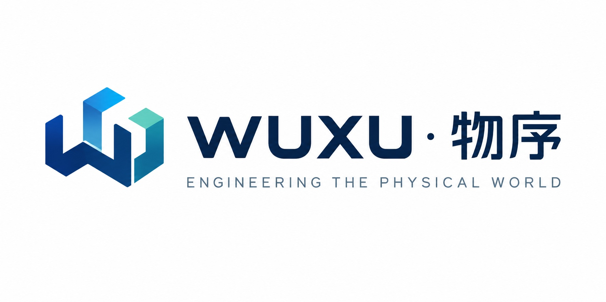

  

# WUXU · 物序

**面向物理世界的可视化专业软件。**

面向观测、理解与模拟物理系统的开源、可自主部署工具。

[English](README.md) · [简体中文](README.zh-CN.md)

---

## 让物理世界变得可见、可知、可模拟

传统工业软件通常围绕生产管理、设备控制或工业自动化构建。WUXU 从一个不同的问题出发：**如何让物理系统变得可见、可知、可模拟？**

我们不做试图同时管理工厂、设备、生产线、能源、仓储与物流的超级平台。我们做目标明确的产品，每个解决一个清晰的问题，并通过共享的模型彼此连接。

可视化不是后加上的报表层，而是产品的主要交互方式。

## 三项核心能力

| 能力 | 回答的问题 | 产品方向 |
|:---|:---|:---|
| **Observe · 感知** | 现在发生了什么？ | 设备监控、IoT、资产管理 |
| **Understand · 理解** | 为什么会这样？ | 数据分析、设备关系、故障诊断 |
| **Simulate · 模拟** | 如果这样做会怎样？ | 数字孪生、仿真、预测 |

## 产品矩阵

<table>
<tr><td width="50%" valign="top">

### 01 · Asset
**设备与资产管理**

设备建模、设备台账、状态监控、传感器数据、设备拓扑。

*设备在哪里、是什么状态、如何管理？*

<b>状态：</b>首个版本开发中

</td><td width="50%" valign="top">

### 02 · Twin
**数字孪生**

设备数字模型、3D 场景建模、实时数据映射、设备关系映射、场景交互。

*真实设备如何拥有可交互的数字映射？*

</td></tr>
<tr><td width="50%" valign="top">

### 03 · Sim
**仿真与模拟**

设备运行仿真、工艺流程模拟、资源调度模拟、离散事件仿真、场景推演。

*不同条件下，系统将会如何运行？*

</td><td width="50%" valign="top">

### 04 · Insight
**工业数据分析**

时序数据分析、设备运行分析、异常检测、能耗分析、运行趋势。

*已经采集的数据里，什么值得被知道？*

</td></tr>
</table>

> *Asset、Twin、Sim、Insight 为产品系列的暂定名称，后续可能调整。*

## 四项原则

- **可视化优先** — 可视化是使用系统的方式，而不是附加的一张图表。
- **开源** — 核心能力开放，鼓励开发者与行业用户参与和扩展。
- **可自主部署** — 本地部署、私有化部署、离线运行是一等能力，而不是企业版附加项。
- **专注垂直领域** — 选择完整而轻量的工具，而不是一个无所不包的大平台。

## 技术栈

| 层级 | 技术 |
|:---|:---|
| 前端 | React + TypeScript |
| 可视化 | React Flow、ECharts、Three.js |
| 后端 | Go |
| 数据接入 | MQTT（Eclipse Mosquitto）、HTTP |
| 数据存储 | PostgreSQL、TimescaleDB（可选） |
| 部署 | Docker Compose |
| 可观测性 | Prometheus、OpenTelemetry |

## 开源与商业

大多数团队需要的核心能力保持开放与免费，企业级能力为持续的开发提供支持。

| 能力 | Community | Enterprise |
|:---|:---:|:---:|
| 设备与资产管理 | ✓ | |
| MQTT / HTTP 接入 | ✓ | |
| 仪表盘与实时监控 | ✓ | |
| 设备拓扑 | ✓ | |
| 基础告警 | ✓ | |
| 高级权限体系 | | ✓ |
| 集群与高可用 | | ✓ |
| 审计与合规 | | ✓ |
| 协议适配与系统集成 | | ✓ |

商业化重点放在企业级能力授权、私有化部署与长期维护、工业协议适配与设备集成，以及行业定制解决方案。开源核心保持开源。

## 参与共建

WUXU 刚刚开始。随着第一个产品的成形，仓库会陆续开放——关注本组织即可看到它们出现。

如果你正在与设备、工厂或物理系统打交道，并希望影响我们要构建的东西，欢迎在对应仓库提交 issue 或发起讨论。

---

WUXU · 物序 — <i>让万物有序，让复杂可见。</i>

